# AD3 - Laboratório Prático com Docker

**Aluno:** Jhonn Lenon da Silva Gonçalves  
**Curso:** Tecnologia em Sistemas para Internet  
**Disciplina:** Tópicos Avançados em Programação Web  
**Atividade:** AD3 - Prática com Docker  

---

## 1. Ambiente de execução

A atividade foi realizada no GitHub Codespaces, ambiente remoto recomendado no roteiro da atividade.

### Print

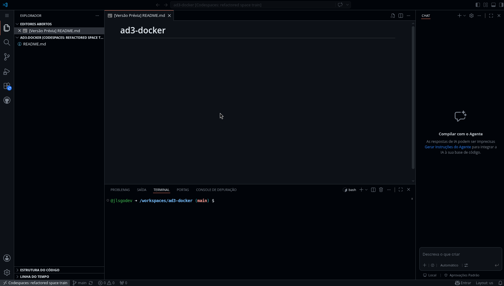

### Resposta

O Codespaces foi utilizado como ambiente de execução da atividade. Ele disponibiliza um ambiente remoto semelhante ao VS Code e permite executar comandos Docker sem a necessidade de instalação local.

---

## 2. Verificando a instalação do Docker

### Comando utilizado

~~~bash
docker --version
~~~

### Print

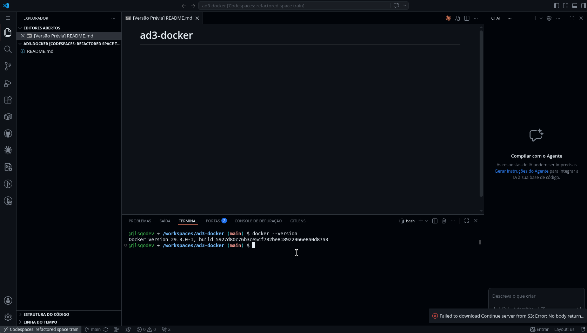

### Resposta

O comando verificou se o Docker estava instalado corretamente no ambiente. A saída exibiu a versão instalada do Docker.

---

## 3. Executando o primeiro container

### Comando utilizado

~~~bash
docker run hello-world
~~~

### Print

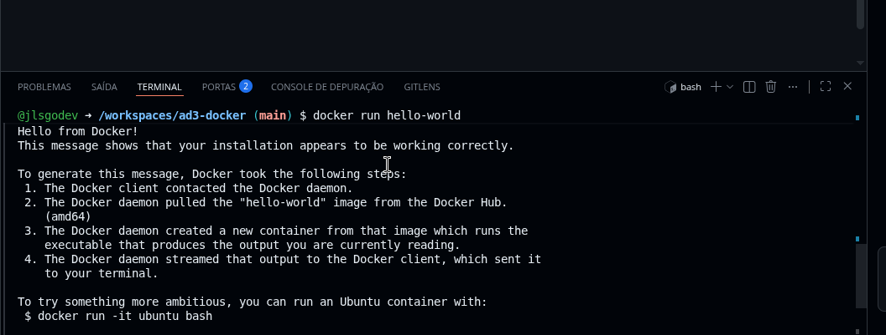

### Resposta

O Docker procurou a imagem `hello-world`. Como a imagem não estava disponível localmente, ela foi baixada do Docker Hub. Em seguida, um container temporário foi criado, executou a mensagem de teste e foi encerrado automaticamente.

---

## 4. Criando um container NGINX

### Comando utilizado

~~~bash
docker run -d -p 8080:80 --name meu-nginx nginx
~~~

### Print

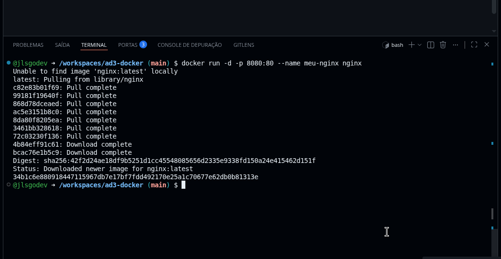

### Resposta

Foi criado um container chamado `meu-nginx` usando a imagem `nginx`. A porta 8080 do ambiente foi mapeada para a porta 80 do container, que é a porta padrão do servidor web NGINX.

---

## 5. Verificando containers em execução

### Comando utilizado

~~~bash
docker ps
~~~

### Print

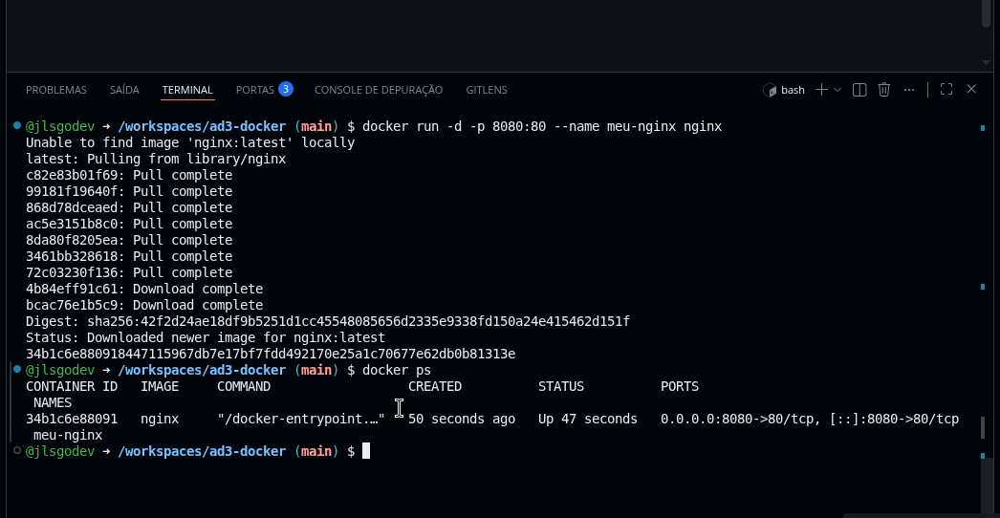

### Resposta

O comando `docker ps` mostrou que o container `meu-nginx` estava em execução, com a porta 8080 mapeada para a porta 80 do container.

---

## 6. Acessando o NGINX pelo navegador

### Print

### Resposta

A página padrão do NGINX foi exibida no navegador, confirmando que o servidor web dentro do container estava funcionando corretamente.

---

## 7. Parando o container

### Comando utilizado

~~~bash
docker stop meu-nginx
~~~

### Print

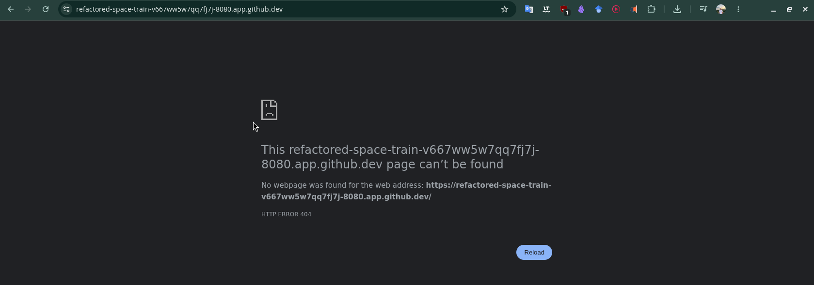

### Resposta

Ao parar o container, o servidor NGINX deixou de responder no navegador. Isso mostrou que a página dependia do container em execução.

---

## 8. Reiniciando o container

### Comando utilizado

~~~bash
docker start meu-nginx
~~~

### Print

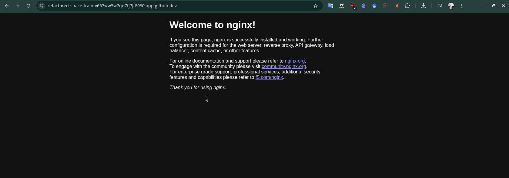

### Resposta

Depois de reiniciar o container, a página do NGINX voltou a ficar acessível no navegador.

---

## 9. Criando um arquivo HTML personalizado

### Comandos utilizados

~~~bash
cat > index.html <<'HTML'
<h1>Meu Site Personalizado no Docker!</h1>

Atividade AD3 - Prática com Docker

Aluno: Jhonn Lenon da Silva Gonçalves

HTML

cat index.html
~~~

### Print

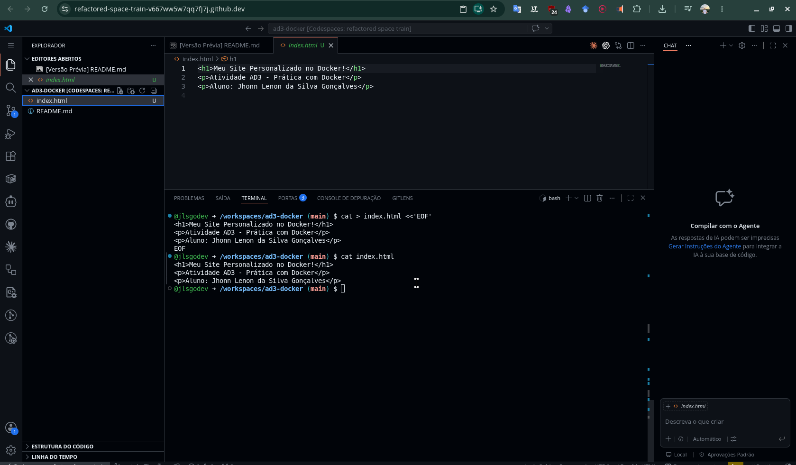

### Resposta

Foi criado um arquivo `index.html` com uma página personalizada para substituir a página padrão do NGINX.

---

## 10. Executando NGINX com volume

### Comando utilizado

~~~bash
docker run -d -p 8081:80 -v $(pwd)/index.html:/usr/share/nginx/html/index.html --name nginx-personalizado nginx
~~~

### Print

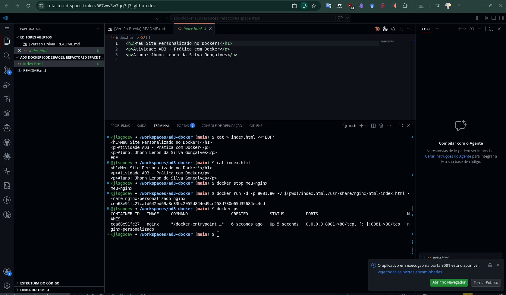

### Resposta

Foi criado um container chamado `nginx-personalizado`. O arquivo local `index.html` foi montado dentro do container no caminho utilizado pelo NGINX para exibir a página inicial.

---

## 11. Acessando a página personalizada

### Print

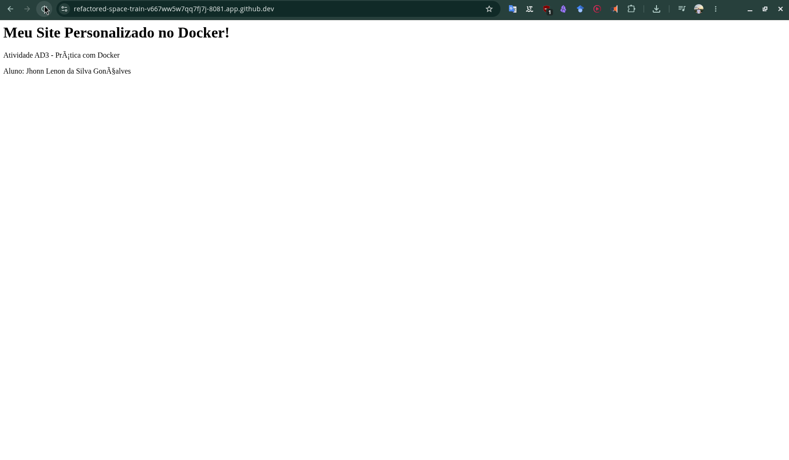

### Resposta

A página personalizada foi exibida no navegador, demonstrando o funcionamento do volume montado entre o arquivo local e o container.

---

## 12. Explorando o container com shell interativo

### Comandos utilizados

~~~bash
docker exec -it nginx-personalizado bash
ls /usr/share/nginx/html
cat /usr/share/nginx/html/index.html
exit
~~~

### Print

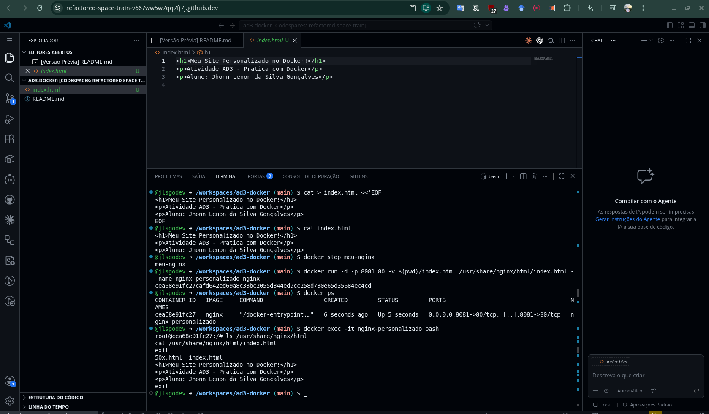

### Resposta

O terminal interno do container foi acessado com `docker exec`. Dentro do container, foi possível listar os arquivos da pasta do NGINX e verificar o conteúdo do arquivo `index.html`.

---

## 13. Limpando containers e imagens

### Comandos utilizados

~~~bash
docker stop meu-nginx nginx-personalizado
docker rm meu-nginx nginx-personalizado
docker ps -a
docker rmi nginx
~~~

### Print

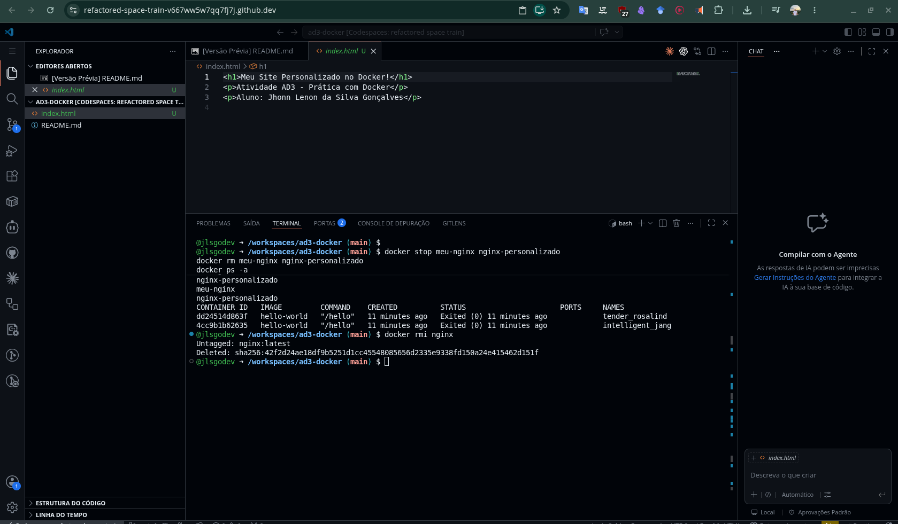

### Resposta

Os containers criados durante a atividade foram parados e removidos. Também foi realizada a tentativa de remoção da imagem `nginx`.

---

## Conclusão

Nesta atividade, pratiquei os principais comandos do Docker, incluindo execução de containers, mapeamento de portas, criação de servidor NGINX, montagem de volume com arquivo HTML personalizado, acesso ao shell interno de um container e limpeza de containers e imagens.

A prática mostrou como o Docker permite executar aplicações em ambientes isolados, de forma leve e reproduzível.
